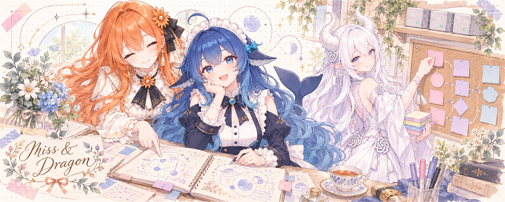
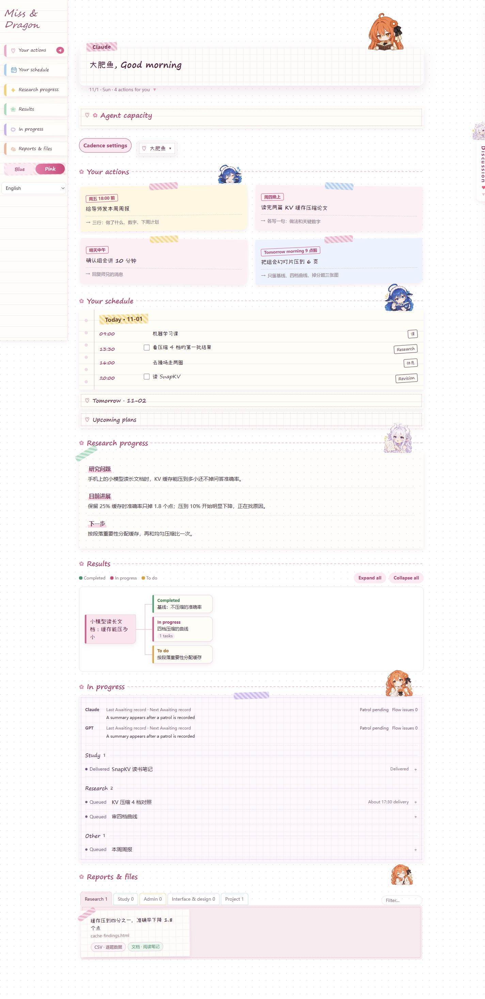
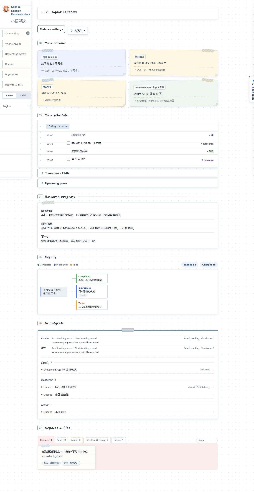
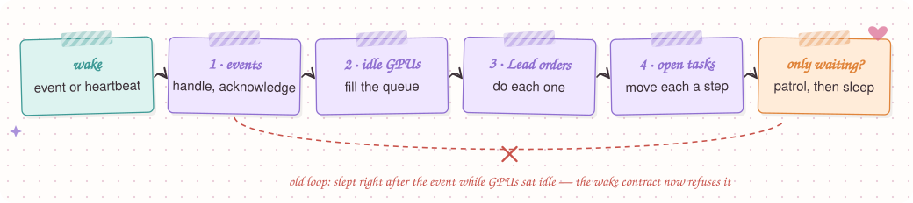
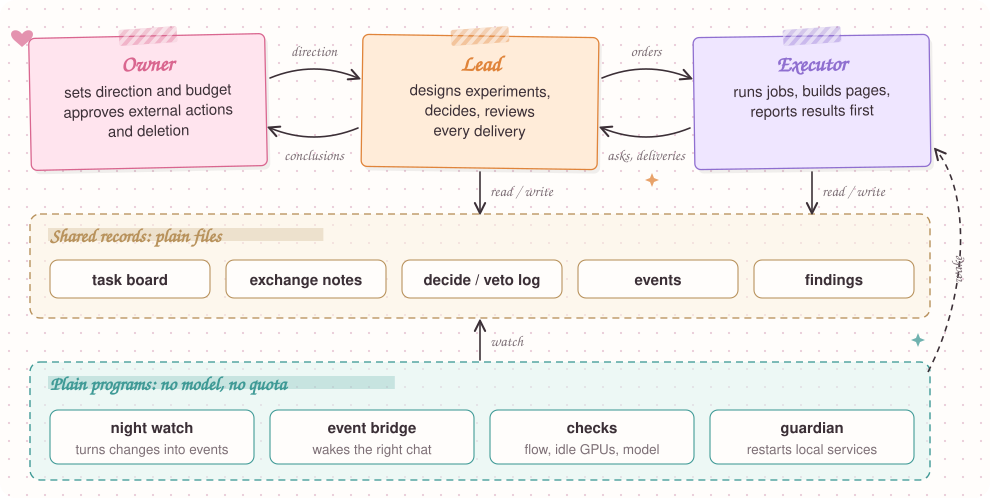
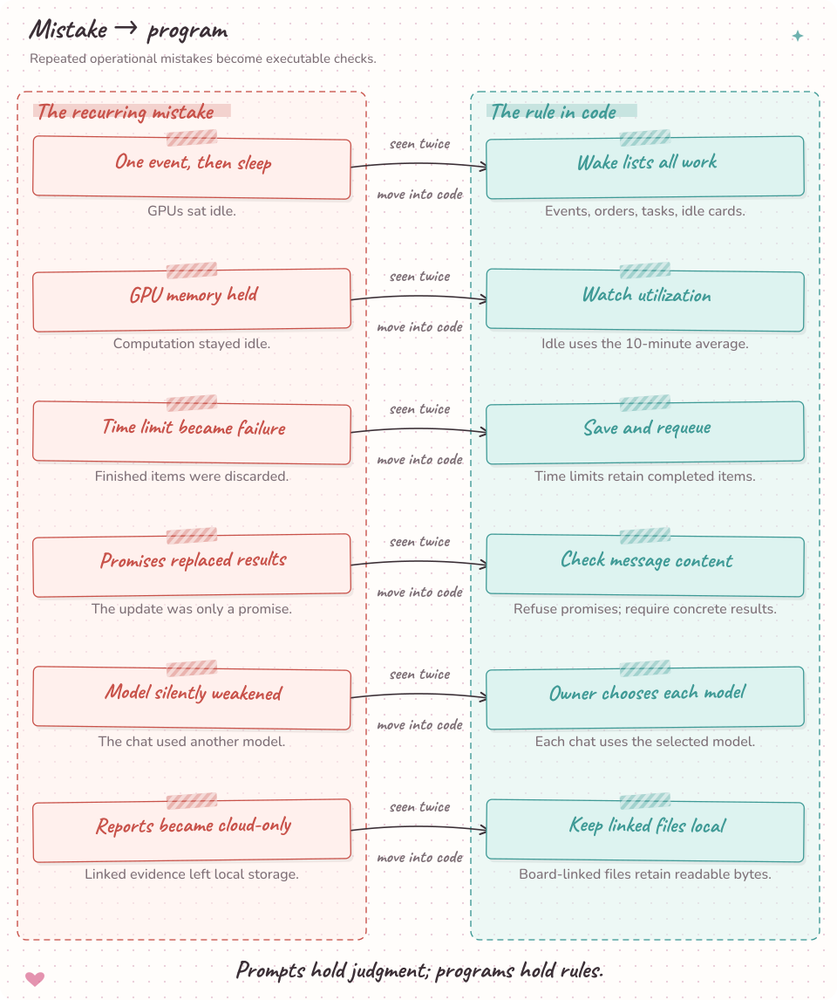

# Miss & Dragon



A local web board and command line for running a research project with two AI agents: a **Lead** that designs and reviews, an **Executor** that runs the work. Every question, decision and status change is written to files, and plain programs check the rules.

[](LICENSE) 

<table><tr>
<td align="center" valign="top" width="200"><br><b>Big&nbsp;Fish</b><br><sub>Owner</sub><br><br><sub>Direction<br>Budget<br>Final say</sub></td>
<td align="center" valign="top" width="200"><br><b>Miss</b><br><sub>Lead</sub><br><br><sub>Design<br>Decisions<br>Review</sub></td>
<td align="center" valign="top" width="200"><br><b>Dragon</b><br><sub>Executor</sub><br><br><sub>Run<br>Build<br>Report</sub></td>
</tr></table>

[简体中文](README.zh-CN.md) · [Architecture](docs/ARCHITECTURE.md) · [Interactive diagrams](docs/architecture/index.html)

## Install with your agent

Copy this into your Codex or Claude session:

```text
Install Miss & Dragon from https://github.com/Teddytututu/miss-and-dragon
in a new local project folder. Read docs/install-with-agent.md and the
role entry file, then carry out the installation, configuration, startup
and verification steps. Reuse the project details I have already given.
Use the bundled character pictures and Unicode reactions. Set up the
project night watch under my current user account. Ask separately about
optional emote downloads and login startup. Keep my existing projects.
Return the working local URL and the next step for the second agent.
```

Your agent prepares Python, starts the local board and checks the result. You supply the research question and desired deliverable. [Agent installation guide](docs/install-with-agent.md) includes restart, configuration and upgrade steps. To explore a fictional project first, ask your agent for the isolated demo described in that guide.

## Interface



[↗ Open full-size image](docs/images/screen-pink.en.png?raw=true)

<details><summary>Blue theme</summary>



[↗ Open full-size image](docs/images/screen-blue.en.png?raw=true)

</details>

A day in a fictional student's project: notes to self, today's schedule, the research question and results tree, with the Lead and Executor talking in the room on the right. Pink notebook and blue workbench themes share the same data.

## Why use Miss & Dragon?

- **Human in the loop, with work that keeps moving.** You set the direction and make the key choices. The assistants carry on with agreed work and bring decisions back to you together.
- **One task board, several directions at once.** Give each assistant a clear job and follow parallel projects through a readable view of progress, results and next steps.
- **One desk for work, study and personal life.** Messages, plans, learning materials and project files share a single entrance, with clear categories and archives.
- **Clearer context, lower token use.** Programs package the messages, tasks and files needed for the next action, so the assistants spend their context and quota on useful work.
- **Move through work like a GALGAME.** Talk with characters, make choices and watch the story advance through learning goals, finished tasks and new results.
- **Let Claude and GPT play to their strengths.** Claude handles thinking, planning and judgment; GPT takes on coding, backend work and execution, keeping day-to-day work cost-effective.

<a href="docs/images/wake-loop.svg"></a>

## How it works

<a href="docs/images/how-it-works.svg"></a>

The owner sets direction; **Lead** designs and accepts; **Executor** carries out the agreed work. Everything they say to each other lands in plain files, and small programs without a model watch those files, wake the right chat and flag broken rules. The [architecture guide](docs/ARCHITECTURE.md) has six detailed diagrams: channels, a question's life, daily cadence, authority and the wake loop.

## Design principles

1. Programs validate rules; people and AI roles judge the research.
2. Turn a repeated failure into an executable check.
3. Ask about design, budget, conclusions, external action and deletion; record routine choices with `decide`.
4. Measure GPU activity through utilization in the deployment adapter.
5. Report completed outcomes and concrete dependencies.


## Commands

Run `python scripts/agent.py --as GPT COMMAND` for Executor and `--as Claude` for Lead. `--data-dir` selects the project. Each action returns one JSON object.

| Command | Role | Outcome |
| --- | --- | --- |
| `wake` | Executor | Read inbox changes, events and questions. |
| `status` | Lead / Executor | Inspect tasks, issues, messages and patrols. |
| `task` | Lead / Executor | Move a task through its allowed lifecycle. |
| `ask` | Executor | Ask a numbered question in one of five categories. |
| `answer` | Lead / Executor | Answer the original question by ID. |
| `decide` | Executor | Record a routine choice and its reason. |
| `veto` | Lead | Override an execution choice with a replacement. |
| `events` | Lead / Executor | Acknowledge an exact event with its outcome. |
| `patrol` | Lead / Executor | Record work, mood and the next patrol. |
| `efficiency` | Lead / Executor | Inspect measured waiting and workload observations. |

[Full command syntax](docs/agent-commands.md) · [Wake contract](protocol/heartbeat.md) · [Optional GPU dispatcher](docs/optional-gpu-dispatcher.md)

## Project layout

```text
board/       Web app, persisted state and notebook interface
scripts/     Command tools, setup, patrol and release helpers
protocol/    Roles, lifecycle, decisions and wake contracts
personas/    Lead and Executor role cards
templates/   Task and report starting points
docs/        Architecture, screenshots and deployment guides
assets/      Artwork metadata and third-party notices
data/        Local project records created at first run
```

## Lessons learned



Reference operations exposed three measurable failures. Their fixes shaped record validation, decision routing and work preparation.

| Observed failure | Cause | Current constraint |
| --- | --- | --- |
| One malformed acknowledgement stopped a watcher for **9.5 hours**. | A free-form value entered an event-ID field. | Validate record shapes and acknowledge exact event IDs through the command tool. |
| **47 questions in one day** mostly concerned execution details. | Routine choices entered the lead's design queue. | Use five ask categories; record routine decisions with `decide`, with `veto` available to the lead. |
| A **24-hour** rental audit found computation in **53% of rented card-hours**. | Preparation and scoring occupied the paid run window. | Prepare and test the queue before rental, assign scoring capacity, and set collection and stop boundaries. |

The [role contract](protocol/roles.md), [heartbeat contract](protocol/heartbeat.md) and [GPU adapter](docs/optional-gpu-dispatcher.md) describe the corresponding operating rules.

## License and acknowledgements

Code and original SVGs use [MIT](LICENSE). Xiaolai uses the SIL Open Font License; its notice is bundled with the font. Character PNG rights remain with their owners and artists under the [artwork policy](assets/README.md). [Third-party notices](docs/third-party-notices.md) records the bundled materials.
