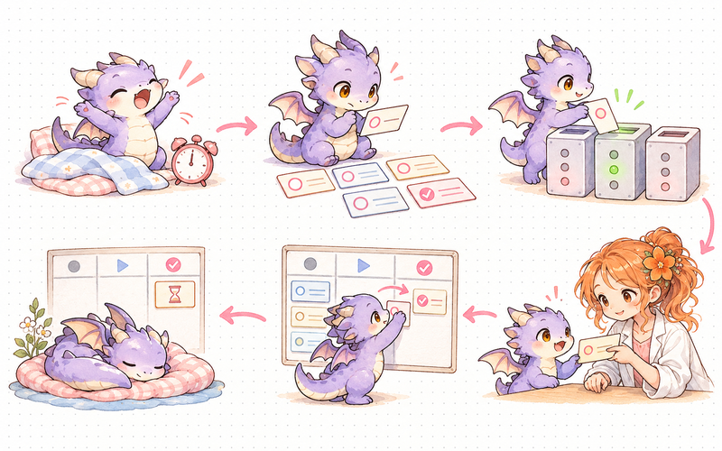
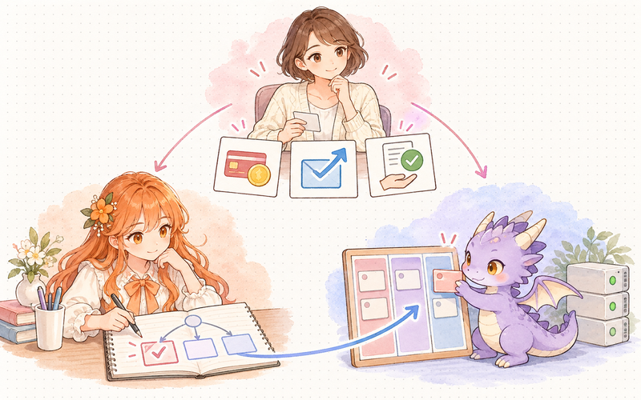
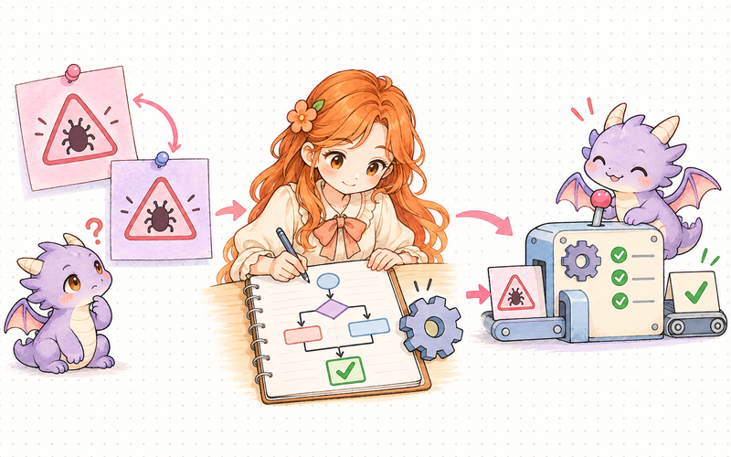

# Miss & Dragon


A local web board and command line for running a research project with two AI agents: a **Lead** that designs and reviews, an **Executor** that runs the work. Every question, decision and status change is written to files, and plain programs check the rules.

[](LICENSE) 

[简体中文](README.zh-CN.md) · [Architecture](docs/ARCHITECTURE.md) · [Interactive diagrams](docs/architecture/index.html)

## Quick start

Python 3.11 or newer. From the repository folder, install the dependency, create fictional demo data, and start the board:

```sh
python -m pip install -r requirements.txt
python -m board start "Example study" --demo --init-only --question "Which method helps?" --deliverable "A reproducible comparison"
python -m board start "Example study"
```

Open **http://127.0.0.1:8780** and keep the last command running. Most interface labels are in Chinese for now. Add `--data-dir` for another project or `--port` for another local port. [Bootstrap](scripts/bootstrap.py), [startup](docs/night-watch.md) and [provider integration](docs/provider-bridge.md) cover environment setup and optional automation.

## Why: beyond two chat windows

- Questions, decisions, status and results persist in project files that either AI can reopen.
- Five numbered ask categories cover design, budget, conclusions, external actions and deletion.
- Routine choices enter a `decide` ledger, and the lead can override them with `veto`.
- The wake contract keeps messages, orders and independent open work in view before patrol.
- Ordinary programs validate record shapes, command fields and task transitions.



## How it works

The owner sets direction and authorization. **Lead** designs and accepts results; **Executor** implements the agreed work. The board and CLI retain their questions, decisions, status and results in files.




The repository ships the board, command tools and record validation. Deployment adapters connect provider wakes, GPU queues, resource guards and service recovery; the reference deployment separates Front desk, Experiment and Chores chats.


Exchange notes carry questions and answers; `decide` and `veto` preserve routine choices and overrides. Private conversations connect the owner to each AI role.


Orange and purple lanes represent model chats; teal lanes represent ordinary programs. Provider schedules and deployment adapters supply the reference cadence.

## Design principles

1. Programs validate rules; people and AI roles judge the research.
2. Turn a repeated failure into an executable check.
3. Ask about design, budget, conclusions, external action and deletion; record routine choices with `decide`.
4. Measure GPU activity through utilization in the deployment adapter.
5. Report completed outcomes and concrete dependencies.



## Commands

Run `python scripts/agent.py --as GPT COMMAND` for Executor and `--as Claude` for Lead. `--data-dir` selects the project. Each action returns one JSON object.

| Command | Role | Outcome |
| --- | --- | --- |
| `wake` | Executor | Read inbox changes, events and questions. |
| `status` | Lead / Executor | Inspect tasks, issues, messages and patrols. |
| `task` | Lead / Executor | Move a task through its allowed lifecycle. |
| `ask` | Executor | Ask a numbered question in one of five categories. |
| `answer` | Lead / Executor | Answer the original question by ID. |
| `decide` | Executor | Record a routine choice and its reason. |
| `veto` | Lead | Override an execution choice with a replacement. |
| `events` | Lead / Executor | Acknowledge an exact event with its outcome. |
| `patrol` | Lead / Executor | Record work, mood and the next patrol. |
| `efficiency` | Lead / Executor | Inspect measured waiting and workload observations. |

[Full command syntax](docs/agent-commands.md) · [Wake contract](protocol/heartbeat.md) · [Optional GPU dispatcher](docs/optional-gpu-dispatcher.md)

## Project layout

```text
board/       Web app, persisted state and notebook interface
scripts/     Command tools, setup, patrol and release helpers
protocol/    Roles, lifecycle, decisions and wake contracts
personas/    Lead and Executor role cards
templates/   Task and report starting points
docs/        Architecture, screenshots and deployment guides
assets/      Artwork metadata and third-party notices
data/        Local project records created at first run
```

## Lessons learned

Reference operations exposed three measurable failures. Their fixes shaped record validation, decision routing and work preparation.

| Observed failure | Cause | Current constraint |
| --- | --- | --- |
| One malformed acknowledgement stopped a watcher for **9.5 hours**. | A free-form value entered an event-ID field. | Validate record shapes and acknowledge exact event IDs through the command tool. |
| **47 questions in one day** mostly concerned execution details. | Routine choices entered the lead's design queue. | Use five ask categories; record routine decisions with `decide`, with `veto` available to the lead. |
| A **24-hour** rental audit found computation in **53% of rented card-hours**. | Preparation and scoring occupied the paid run window. | Prepare and test the queue before rental, assign scoring capacity, and set collection and stop boundaries. |

The [role contract](protocol/roles.md), [heartbeat contract](protocol/heartbeat.md) and [GPU adapter](docs/optional-gpu-dispatcher.md) describe the corresponding operating rules.

## License and acknowledgements

Code and original SVGs use [MIT](LICENSE). Xiaolai uses the SIL Open Font License; its notice is bundled with the font. Character PNG rights remain with their owners and artists under the [artwork policy](assets/README.md). [Third-party notices](docs/third-party-notices.md) records the bundled materials.
