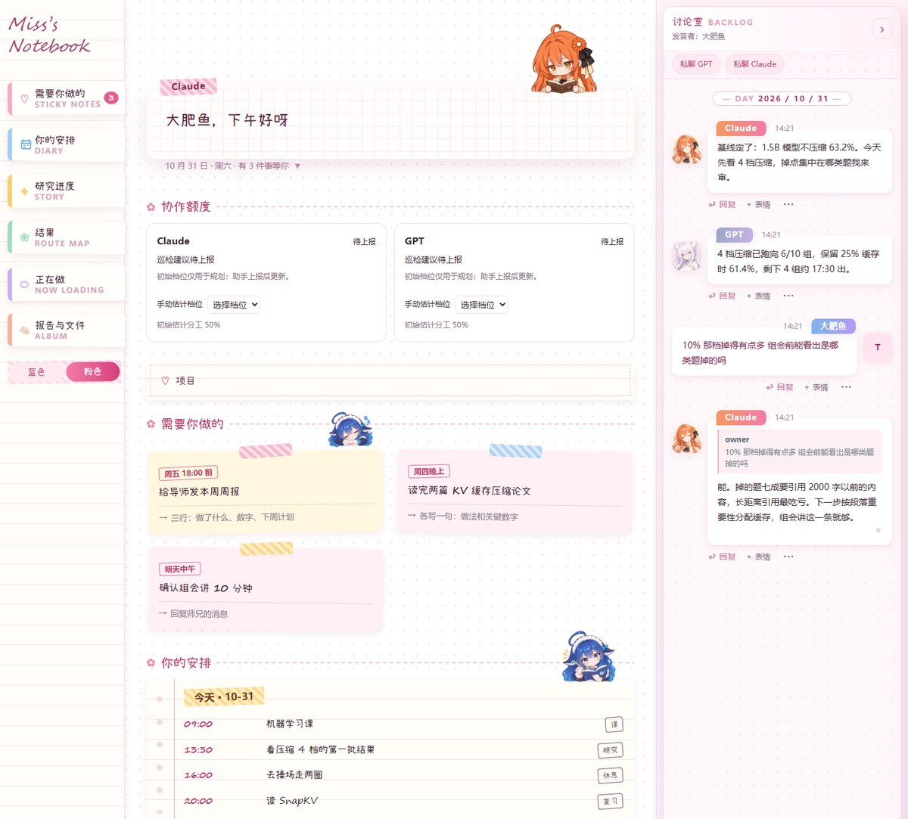
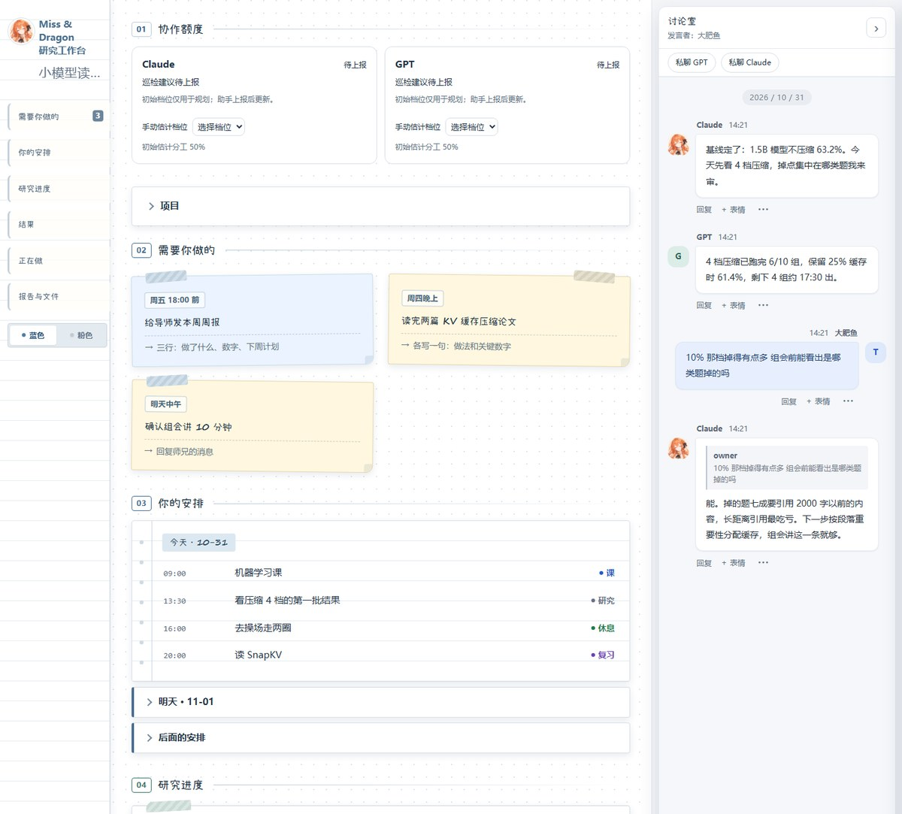

# Miss & Dragon


A local web board and command line for running a research project with two AI agents: a **Lead** that designs and reviews, an **Executor** that runs the work. Every question, decision and status change is written to files, and plain programs check the rules.

[](LICENSE) 

<table><tr>
<td align="center" width="140"><br><b>Owner · 大肥鱼</b><br><sub>direction · budget · final say</sub></td>
<td align="center" width="140"><br><b>Lead · Miss</b><br><sub>designs · decides · reviews</sub></td>
<td align="center" width="140"><br><b>Executor · Dragon</b><br><sub>runs · builds · reports</sub></td>
</tr></table>

[简体中文](README.zh-CN.md) · [Architecture](docs/ARCHITECTURE.md) · [Interactive diagrams](docs/architecture/index.html)

## Interface



<details><summary>Blue theme</summary>



</details>

A day in a fictional student's project: notes to self, today's schedule, the research question and results tree, with the Lead and Executor talking in the room on the right. Pink notebook and blue workbench themes share the same data.

## Quick start

Python 3.11 or newer. From the repository folder, install the dependency and start the board with a fictional student's research day:

```sh
python -m pip install -r requirements.txt
python -m board start --demo
```

Open **http://127.0.0.1:8780** and keep the last command running. Choose **English** or **简体中文** in the sidebar, or open **http://127.0.0.1:8780/?lang=en** directly. Both themes share the language setting; project content keeps its original wording. See [language settings](docs/languages.md). Add `--data-dir` for another project or `--port` for another local port. [Bootstrap](scripts/bootstrap.py), [startup](docs/night-watch.md) and [provider integration](docs/provider-bridge.md) cover environment setup and optional automation.

## Why: beyond two chat windows

- Questions, decisions, status and results persist in project files that either AI can reopen.
- Five numbered ask categories cover design, budget, conclusions, external actions and deletion.
- Routine choices enter a `decide` ledger, and the lead can override them with `veto`.
- The wake contract keeps messages, orders and independent open work in view before patrol.
- Ordinary programs validate record shapes, command fields and task transitions.


## How it works


The owner sets direction; **Lead** designs and accepts; **Executor** carries out the agreed work. Everything they say to each other lands in plain files, and small programs without a model watch those files, wake the right chat and flag broken rules. The [architecture guide](docs/ARCHITECTURE.md) has six detailed diagrams: channels, a question's life, daily cadence, authority and the wake loop.

## Design principles

1. Programs validate rules; people and AI roles judge the research.
2. Turn a repeated failure into an executable check.
3. Ask about design, budget, conclusions, external action and deletion; record routine choices with `decide`.
4. Measure GPU activity through utilization in the deployment adapter.
5. Report completed outcomes and concrete dependencies.


## Commands

Run `python scripts/agent.py --as GPT COMMAND` for Executor and `--as Claude` for Lead. `--data-dir` selects the project. Each action returns one JSON object.

| Command | Role | Outcome |
| --- | --- | --- |
| `wake` | Executor | Read inbox changes, events and questions. |
| `status` | Lead / Executor | Inspect tasks, issues, messages and patrols. |
| `task` | Lead / Executor | Move a task through its allowed lifecycle. |
| `ask` | Executor | Ask a numbered question in one of five categories. |
| `answer` | Lead / Executor | Answer the original question by ID. |
| `decide` | Executor | Record a routine choice and its reason. |
| `veto` | Lead | Override an execution choice with a replacement. |
| `events` | Lead / Executor | Acknowledge an exact event with its outcome. |
| `patrol` | Lead / Executor | Record work, mood and the next patrol. |
| `efficiency` | Lead / Executor | Inspect measured waiting and workload observations. |

[Full command syntax](docs/agent-commands.md) · [Wake contract](protocol/heartbeat.md) · [Optional GPU dispatcher](docs/optional-gpu-dispatcher.md)

## Project layout

```text
board/       Web app, persisted state and notebook interface
scripts/     Command tools, setup, patrol and release helpers
protocol/    Roles, lifecycle, decisions and wake contracts
personas/    Lead and Executor role cards
templates/   Task and report starting points
docs/        Architecture, screenshots and deployment guides
assets/      Artwork metadata and third-party notices
data/        Local project records created at first run
```

## Lessons learned

Reference operations exposed three measurable failures. Their fixes shaped record validation, decision routing and work preparation.

| Observed failure | Cause | Current constraint |
| --- | --- | --- |
| One malformed acknowledgement stopped a watcher for **9.5 hours**. | A free-form value entered an event-ID field. | Validate record shapes and acknowledge exact event IDs through the command tool. |
| **47 questions in one day** mostly concerned execution details. | Routine choices entered the lead's design queue. | Use five ask categories; record routine decisions with `decide`, with `veto` available to the lead. |
| A **24-hour** rental audit found computation in **53% of rented card-hours**. | Preparation and scoring occupied the paid run window. | Prepare and test the queue before rental, assign scoring capacity, and set collection and stop boundaries. |

The [role contract](protocol/roles.md), [heartbeat contract](protocol/heartbeat.md) and [GPU adapter](docs/optional-gpu-dispatcher.md) describe the corresponding operating rules.

## License and acknowledgements

Code and original SVGs use [MIT](LICENSE). Xiaolai uses the SIL Open Font License; its notice is bundled with the font. Character PNG rights remain with their owners and artists under the [artwork policy](assets/README.md). [Third-party notices](docs/third-party-notices.md) records the bundled materials.
