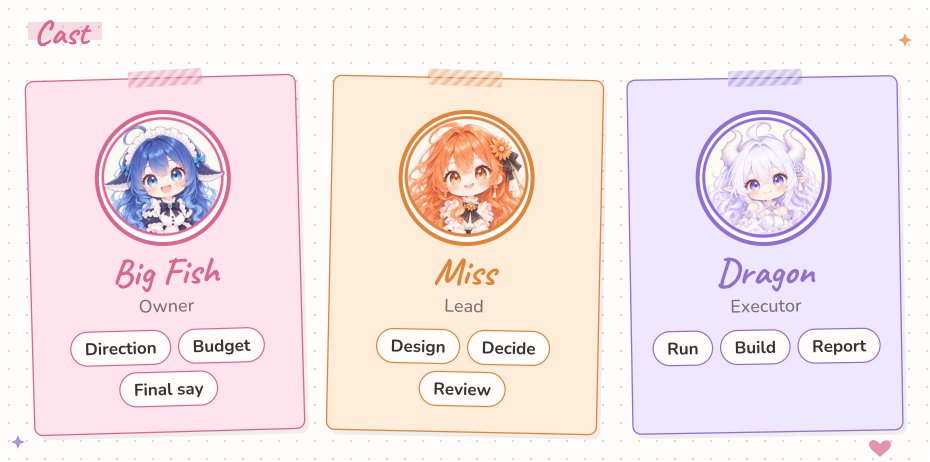

# Miss & Dragon


Run your research like a GALGAME!

[](LICENSE) 



[简体中文](README.zh-CN.md) · [Architecture](docs/ARCHITECTURE.md)

## Install

You need one Codex session and one Claude session, each able to read and write local files and run a terminal. Windows is the smoothest; Mac and Linux work too. You need Python 3.11 or newer, and Codex installs it if it is missing. No GPU is required unless you run experiments.

**1. Send this to Codex (Dragon):**

```text
Install Miss & Dragon for me by following this guide:
https://github.com/Teddytututu/miss-and-dragon/blob/main/docs/install-with-agent.md
```

**2. Answer its questions:**

- what you want to research, and what you want to end up with;
- what you would like to be called (default "Big Fish");
- how many GPT and Claude subscriptions you have, and which plans (for example ChatGPT Plus / Pro, Claude Pro / Max). Patrol frequency is set from this.

**3. When it finishes, it tells you the project folder and the local address. Send this to Claude (Miss), with that folder filled in:**

```text
Join my Miss & Dragon project. The project folder is: <the folder Codex gave you>
Follow section 3 of this guide:
https://github.com/Teddytututu/miss-and-dragon/blob/main/docs/install-with-agent.md
```

Once Claude joins, the two start talking.

Want a look first? Send Codex: `Using that guide, start a demo project for me first.` The demo keeps its data apart from real projects.

## Interface


[↗ Open full-size image](https://raw.githubusercontent.com/Teddytututu/miss-and-dragon/main/docs/images/screen-pink.en.png)

<details><summary>Blue theme</summary>


[↗ Open full-size image](https://raw.githubusercontent.com/Teddytututu/miss-and-dragon/main/docs/images/screen-blue.en.png)

</details>

A day in a fictional student's project: notes to self, today's schedule, the research question and results tree, with Miss and Dragon talking in the room on the right. Pink notebook and blue workbench themes share the same data.

## Why use Miss & Dragon?

- **Human in the loop, with work that keeps moving.** You set the direction and make the key choices. The assistants carry on with agreed work and bring decisions back to you together.
- **One task board, several directions at once.** Give each assistant a clear job and follow parallel projects through a readable view of progress, results and next steps.
- **One desk for work, study and personal life.** Messages, plans, learning materials and project files share a single entrance, with clear categories and archives.
- **Clearer context, lower token use.** Programs package the messages, tasks and files needed for the next action, so the assistants spend their context and quota on useful work.
- **Move through work like a GALGAME.** Talk with characters, make choices and watch the story advance through learning goals, finished tasks and new results.
- **Let Claude and GPT play to their strengths.** Claude handles thinking, planning and judgment; GPT takes on coding, backend work and execution, keeping day-to-day work cost-effective.
- **Agents that grow with you.** Claude and GPT get better as you use them: your corrections, preferences and past mistakes go into their role cards and rule files, and the teamwork gets smoother every day.

## How it works

<a href="docs/images/how-it-works.svg"></a>

You (Big Fish) set the direction; Miss designs and accepts; Dragon carries out the agreed work. Everything they say to each other lands in plain files, and small programs without a model watch those files, wake the right chat and flag broken rules. The [architecture guide](docs/ARCHITECTURE.md) has six detailed diagrams: channels, a question's life, daily cadence, authority and the wake loop.

<a href="docs/images/wake-loop.svg"></a>

## Design principles

Your time is the scarcest thing here, so:

1. What needs you sits at the top; details stay in files.
2. Reports give results, with evidence when needed, and skip the process.
3. Recurring mistakes are fixed with programs.

## Pitfalls we hit

**GPT asks you dozens of questions a day?**
The worst day had 47, mostly small stuff. Now her questions go to Miss first, who settles most of them on the spot; only the ones that truly need you reach you.

**Rented GPUs, half unused?**
One 24-hour rental spent only 53% of the time computing. Now the work is prepared and test-run before the rental starts.

**Cards idle, AI asleep?**
Dragon used to handle one thing and go back to sleep. Now every wake goes through all open work, and it sleeps only when nothing is left.

**The backend stopped overnight and nobody noticed?**
One badly formatted record made the night watch stall for 9.5 hours. Now records are format-checked before they are written, so a bad one never gets in.


<details><summary>For developers: commands and layout</summary>

The two agents read messages, move tasks, ask questions and log patrols through `python scripts/agent.py`; you never need to type a command. [Full command syntax](docs/agent-commands.md) · [Role contract](protocol/roles.md) · [Wake contract](protocol/heartbeat.md) · [Optional GPU dispatcher](docs/optional-gpu-dispatcher.md)

```text
board/       Web app, persisted state and notebook interface
scripts/     Command tools, setup, patrol and release helpers
protocol/    Roles, lifecycle, decisions and wake contracts
personas/    Role cards for Miss and Dragon
templates/   Task and report starting points
docs/        Architecture, screenshots and deployment guides
assets/      Artwork metadata and third-party notices
data/        Local project records created at first run
```

</details>

## License and acknowledgements

Code and original SVGs use [MIT](LICENSE). Xiaolai uses the SIL Open Font License; its notice is bundled with the font. Character PNG rights remain with their owners and artists under the [artwork policy](assets/README.md). [Third-party notices](docs/third-party-notices.md) records the bundled materials.

Each owner message stays pending until an assistant replies or explicitly chooses `react --enough`; ordinary reactions remain acknowledgements.
