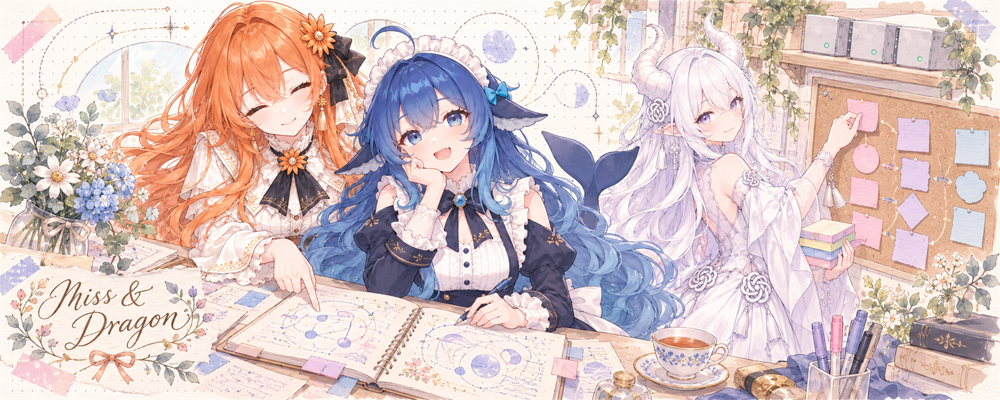
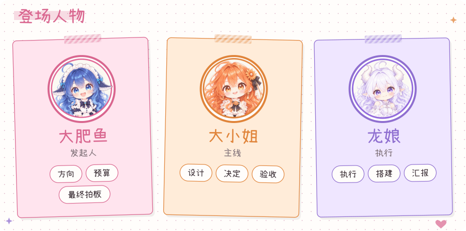
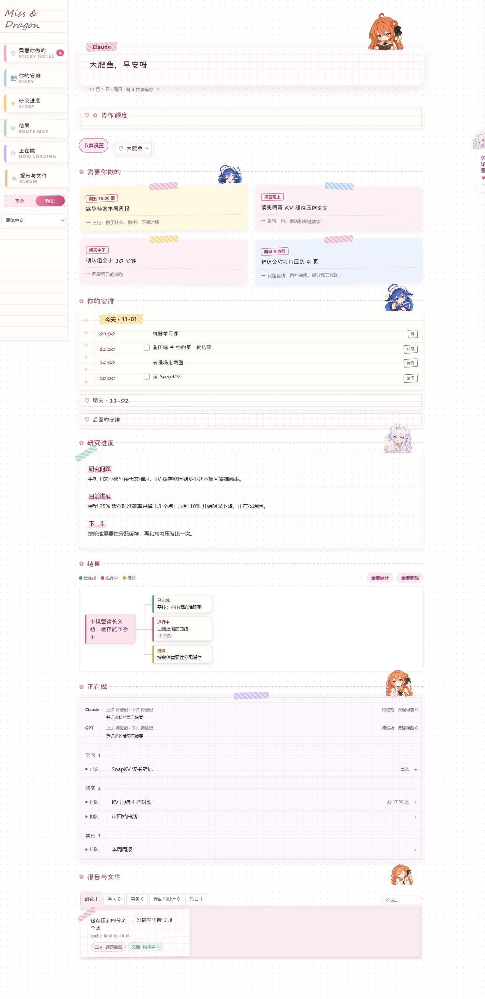
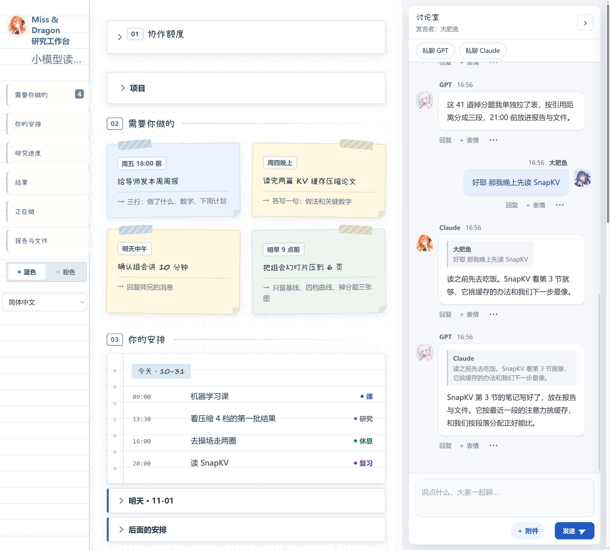
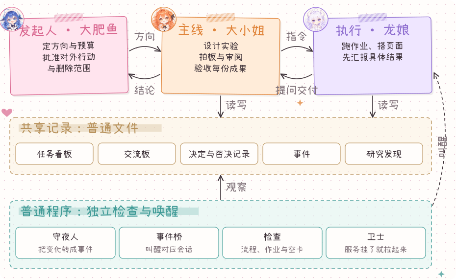
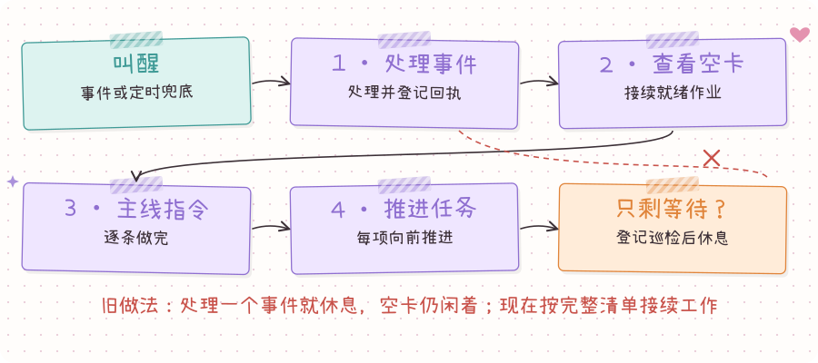
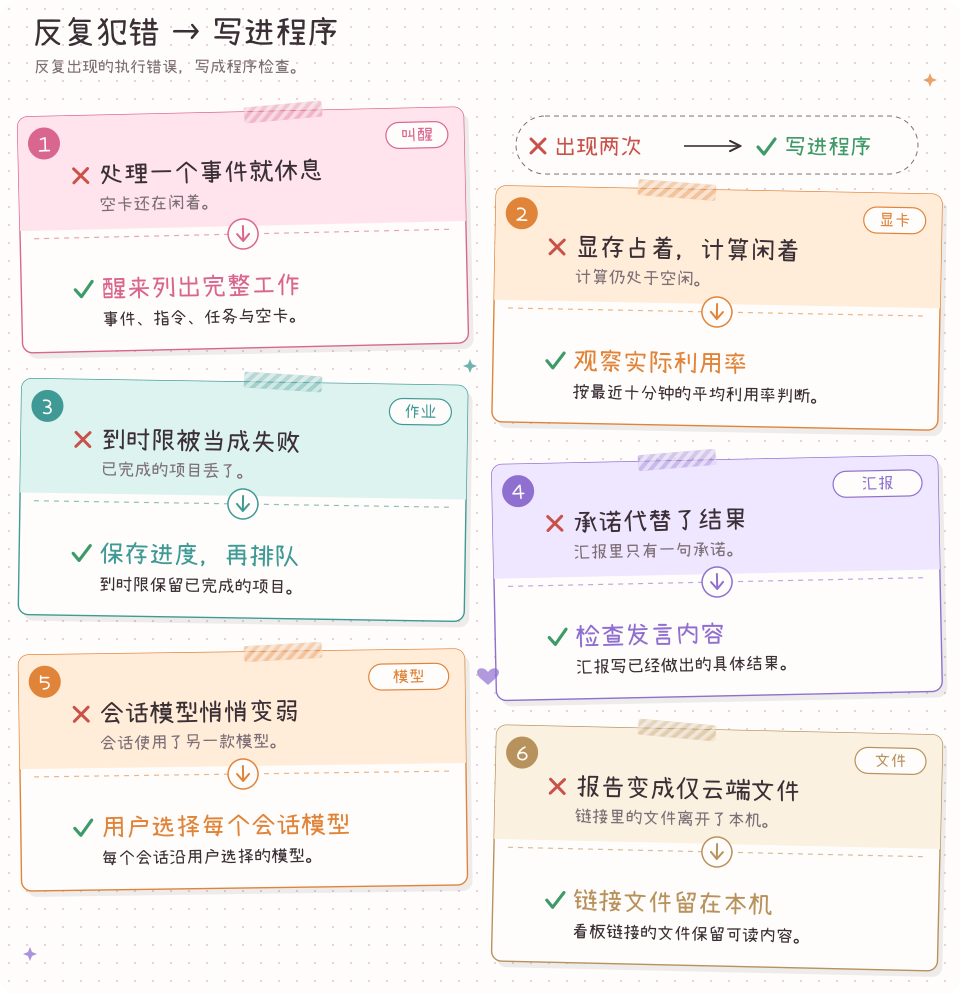

# Miss & Dragon



像 GALGAME 一样推进你的研究！

[](LICENSE) 



[English](README.md) · [架构说明](docs/ARCHITECTURE.md)

## 安装

你需要：Codex 和 Claude 各开一个会话，都要能读写本机文件、能跑终端。Windows 上最省心，Mac 和 Linux 也能跑；电脑上要有 Python 3.11 以上，没有的话 Codex 会帮你装；不需要显卡，跑实验时才用得上。

**1. 发给 Codex（龙娘）：**

```text
帮我安装 Miss & Dragon，按这份说明做：
https://github.com/Teddytututu/miss-and-dragon/blob/main/docs/install-with-agent.zh-CN.md
```

**2. 回答它的几个问题：**

- 你想研究什么，想得到什么成果；
- 希望怎么称呼你（默认“大肥鱼”）；
- GPT 和 Claude 各有几个订阅、什么档位（比如 ChatGPT Plus / Pro，Claude Pro / Max）。巡检多勤快按这个定。

**3. 装好后它会告诉你项目文件夹和本机网址。把下面这句发给 Claude（大小姐），换上那个文件夹：**

```text
加入我的 Miss & Dragon 项目，项目文件夹是：<Codex 告诉你的文件夹>
按这份说明的第 3 节做：
https://github.com/Teddytututu/miss-and-dragon/blob/main/docs/install-with-agent.zh-CN.md
```

Claude 加进来以后，两边就开始对话了。

想先看看再装？发给 Codex：`按上面那份文件，先给我开一个演示项目。` 演示项目和正式项目的数据分开放。

## 界面



[↗ 查看高清原图](https://raw.githubusercontent.com/Teddytututu/miss-and-dragon/main/docs/images/screen-pink.zh-CN.png)

<details><summary>蓝色主题</summary>



[↗ 查看高清原图](https://raw.githubusercontent.com/Teddytututu/miss-and-dragon/main/docs/images/screen-blue.zh-CN.png)

</details>

一个虚构学生的研究日常：要做的事、今天的安排、研究问题和结果树，右边是大小姐和龙娘在讨论室里的对话。粉色手账和蓝色工作台两套主题用同一份数据。

## 为什么选 Miss & Dragon

- **人在环中，任务持续推进。** 你把握方向和关键选择，AI 接着做已经约定好的工作，把真正需要你决定的事情集中带回来。
- **一块任务板，多条线一起推进。** 给各个 AI 分清工作，用清楚的进度、结果和下一步，同时跟上几个项目。
- **工作、学习和个人事务，一个入口。** 消息、安排、学习资料和项目文件放在同一张桌面，分类清楚，归档也方便找。
- **程序整理上下文，省下模型额度。** 消息、任务和文件由程序打包成下一步所需的信息，让 AI 把上下文和额度用在具体工作上。
- **像玩 GALGAME 一样推进学习和工作。** 和角色对话、做出选择，看学习目标、完成的任务和新结果推动故事向前。
- **让 Claude 和 GPT 各展所长。** Claude 负责思考、规划和判断，GPT 承担代码、后端和具体执行，以更经济的方式把日常工作做完。
- **越用越得心应手。** Claude 和 GPT 在使用中养成和成长：你纠正过的说法、定下的偏好、踩过的坑都会记进角色卡和规则文件，配合一天比一天默契。

## 怎样协作

<a href="docs/images/how-it-works.zh-CN.svg"></a>

你（大肥鱼）定方向，大小姐设计和验收，龙娘做约定好的事。她们之间说的每句话都落在普通文件里，几个不用模型的小程序看着这些文件：把变化变成事件、叫醒对的会话、发现规矩被破坏就报出来。[架构说明](docs/ARCHITECTURE.md)里有六张细图：通道、一个问题的一生、每日节奏、决定权和醒来循环。

<a href="docs/images/wake-loop.zh-CN.svg"></a>

## 设计原则

你的时间最贵，所以：

1. 要你做的事放最上面，细节留在文件里。
2. 汇报只说结果，需要时附上证据，不说过程。
3. 反复出现的错，用程序解决。

## 踩过的坑

**GPT 一天问几十个问题？**
最多的一天问了 47 次，大半是小事。现在她的问题先交给大小姐，大部分当场拍板，只有真要你定的才轮到你。

**租的卡没用满？**
有次租了 24 小时，真正在算的只有 53%。现在先把活备好、试跑通了再开租。

**卡空着，AI 却睡了？**
以前龙娘处理完一件事就睡。现在醒来先把所有活过一遍，真没事了才睡。

**后台停了一晚上没人知道？**
一条记录格式写错，守夜人读到就卡住，停了 9.5 小时。现在写记录前先查格式，错的写不进去。



<details><summary>给开发者：命令与目录</summary>

两个 AI 通过 `python scripts/agent.py` 读消息、流转任务、提问和记巡检，你不需要敲命令。 [完整命令](docs/agent-commands.md) · [角色约定](protocol/roles.md) · [醒来流程](protocol/heartbeat.zh-CN.md) · [可选 GPU 调度器](docs/optional-gpu-dispatcher.md)

```text
board/       网页应用、持久化状态和手账界面
scripts/     命令、安装、巡检和打包工具
protocol/    角色、生命周期、决定和醒来约定
personas/    大小姐与龙娘的角色卡
templates/   任务与报告模板
docs/        架构图、截图和部署说明
assets/      图像元数据与第三方说明
data/        首次启动创建的本地项目记录
```

</details>

## 许可与致谢

代码和原创 SVG 采用 [MIT](LICENSE)。小赖字体采用 SIL Open Font License，字体随附许可原文。角色 PNG 的权利归原作者和角色权利人，使用范围见[图像说明](assets/README.md)。[第三方声明](docs/third-party-notices.md)记录随附材料。
