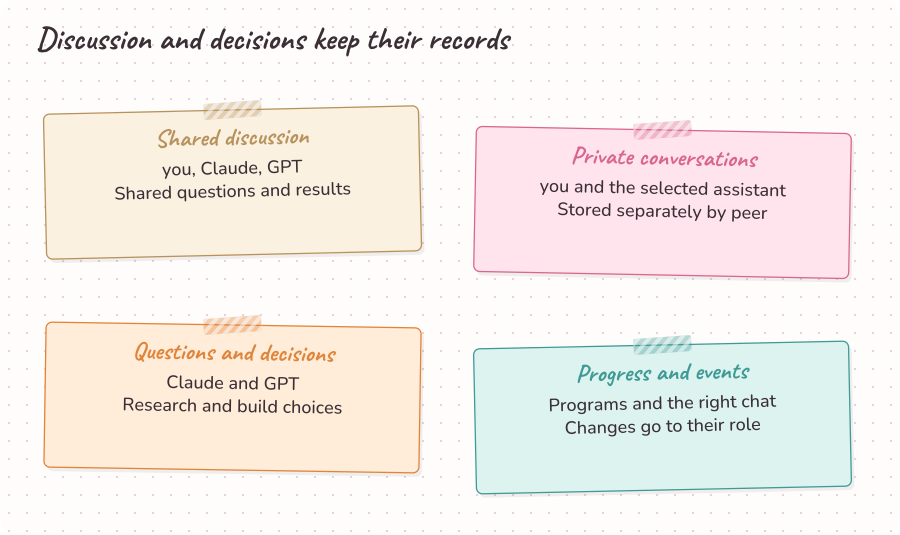
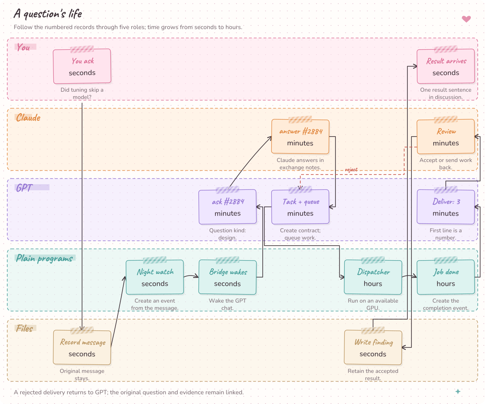
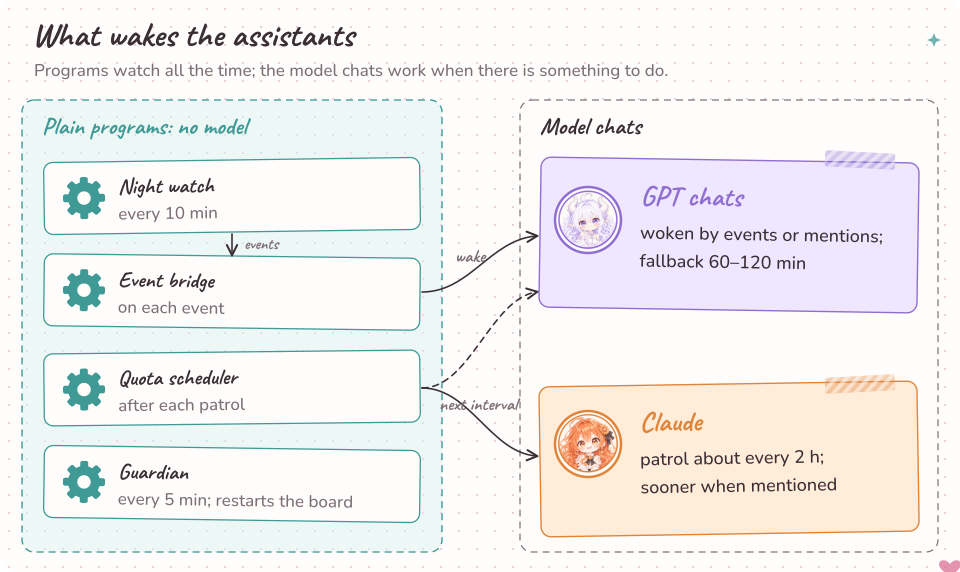
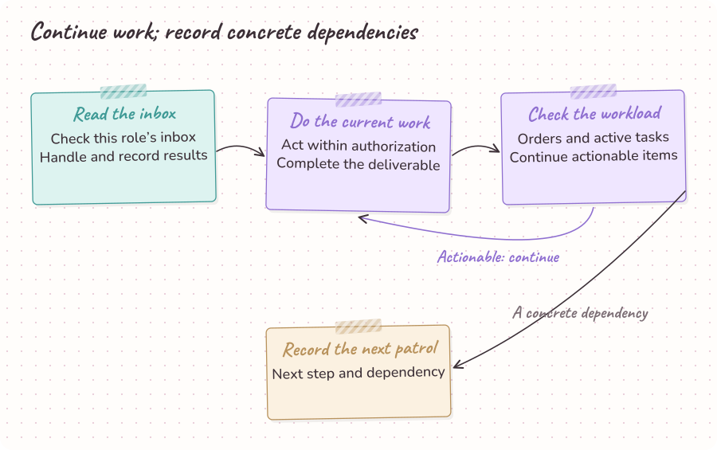

# Architecture

[Project overview](../README.md) · [Interactive diagrams](architecture/index.html)

The local board and CLI retain questions, decisions, tasks and results in files. Lead designs and accepts work; Executor implements it; ordinary programs validate records and transitions.

## Components

| Component | Source | Responsibility |
| --- | --- | --- |
| Owner, Lead and Executor | `protocol/roles.md`, `personas/` | Set direction, design and accept work, then execute within the agreed role. |
| Board and CLI | `board/app.py`, `scripts/agent.py` | Display project records and validate command inputs. |
| Task contracts and lifecycle | `templates/`, `board/lifecycle.py`, `scripts/task_flow.py` | Create, queue, run, block, deliver and accept work through allowed transitions. |
| Discussion and private conversations | `board/private_notes.py`, `scripts/private_chat.py`, `scripts/post_message.py` | Retain separate conversations, replies and message state. |
| Questions, decisions and factual requests | `board/exchange.py`, `board/agent_tools.py` | Join numbered questions and answers; retain choices and lead overrides. |
| Night watch and event IDs | `scripts/night_watch.py`, `board/watch_rules.py` | Observe configured tasks and retain actionable, deduplicated events. |
| Inbox and status | `scripts/agent.py`, `board/agent_tools.py` | Read inbox changes and the current task workload. |
| GPU hosts, resource guard and dispatcher | `docs/optional-gpu-dispatcher.md`, `docs/optional-resource-guard.md` | Connect deployment-specific jobs, loading checks, receipts and utilization. |
| Guardian and chat-delivery bridge | `docs/night-watch.md`, `docs/optional-event-bridge.md` | Configure service recovery and model-chat event delivery. |
| Efficiency observations | `scripts/agent.py efficiency`, `board/agent_tools.py` | Record observed work and waiting, with missing observations represented explicitly. |

## 1. People, chats and persistent records

The owner sets direction, Lead designs and accepts results, and Executor implements the agreed work. Model chats write records; ordinary programs check and retain them.

## 2. Communication channels

Discussion and private conversations retain messages, while exchange notes carry numbered questions and answers. The decision ledger preserves routine choices and lead vetoes across chats.

## 3. From question to accepted result

A question becomes a task contract, an executable run, a result and an acceptance decision. Follow the arrows in that order to locate the record that connects each step.

## 4. Model chats and ordinary programs

Orange and purple lanes represent model chats; teal lanes represent ordinary programs. Provider schedules deliver wakes, Night watch observes tasks, and Guardian handles configured service recovery.

## 5. Decision authority and audit

Five consequential categories enter the lead's ask queue; routine choices enter the decide ledger. Audit findings become engineering changes, and the next review checks their effect.

## 6. One complete wake

The wake contract checks events, eligible work capacity, lead instructions, open tasks and returned work. The closing patrol records the current outcome and concrete dependency.

## Wake loop

`wake` reads inbox changes and `status` exposes the full workload. The bundled CLI retains events, questions, tasks and issues; deployment adapters add role-chat delivery and eligible resource observations.

Experiment checks eligible work capacity, then handles events, instructions and open work. Chores handles events, engineering instructions and independent open tasks. Front desk handles messages, completes scoped local work and records concrete handoffs.

Each role continues until a real dependency remains, then records its patrol and mood. The [heartbeat contract](../protocol/heartbeat.md) and [role cards](../protocol/roles.md) define the complete closing conditions.

## Failure cases

The [observed failures and resulting constraints](../README.md#lessons-learned) are maintained in the README.

## Deployment boundaries

The board binds to loopback. Provider wakes, GPU scheduling and service recovery have separate configuration paths in the deployment adapters; project data and credentials live in local runtime records.
