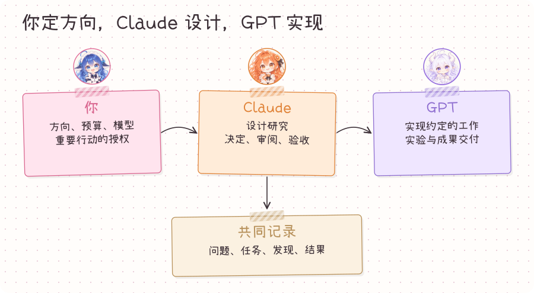
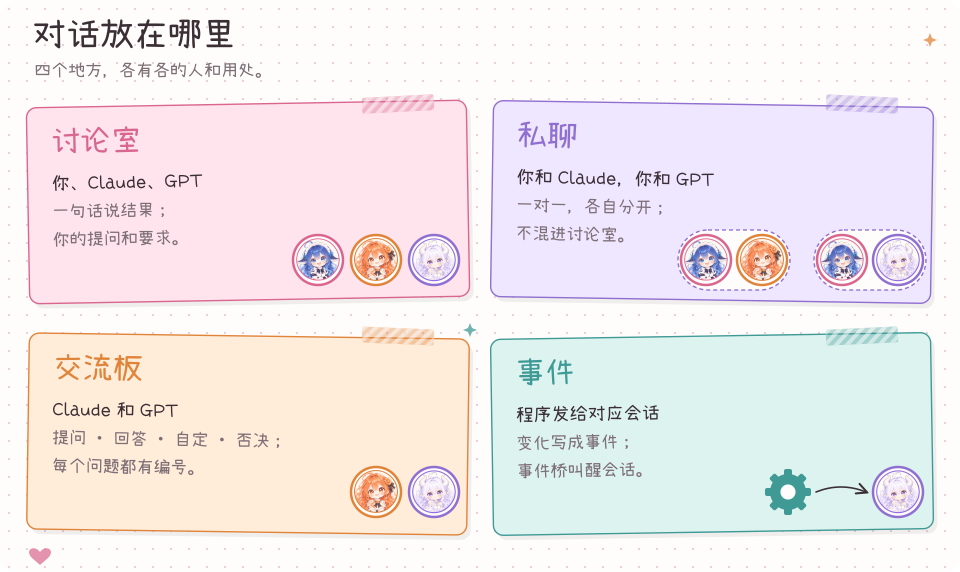
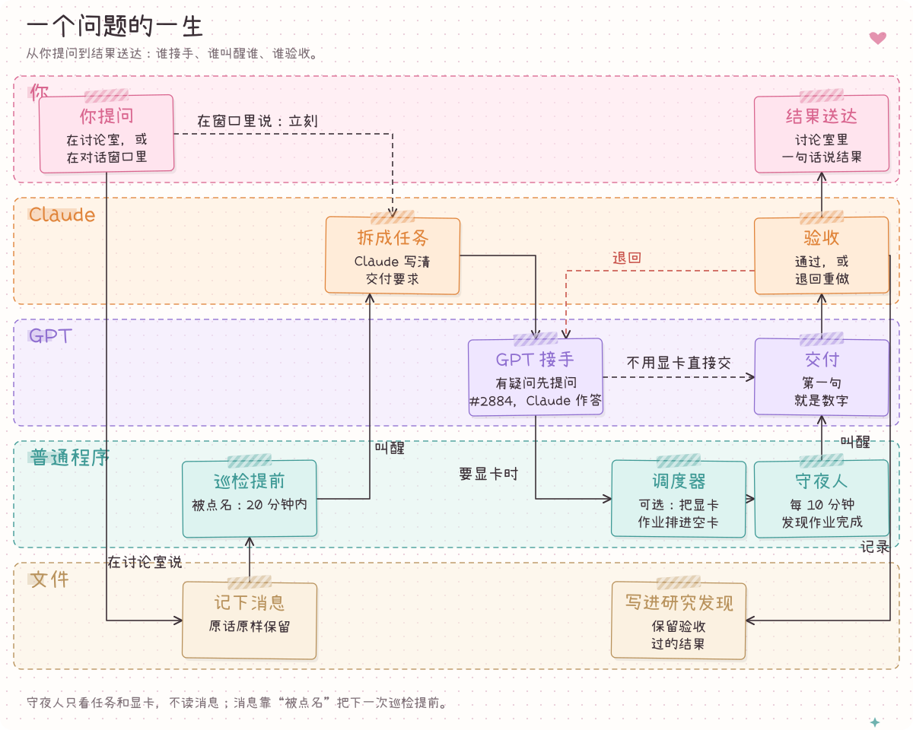
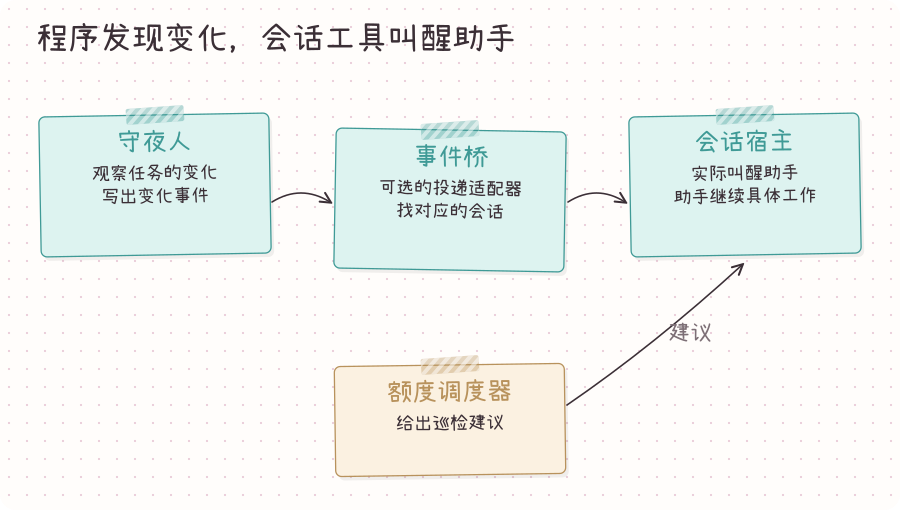
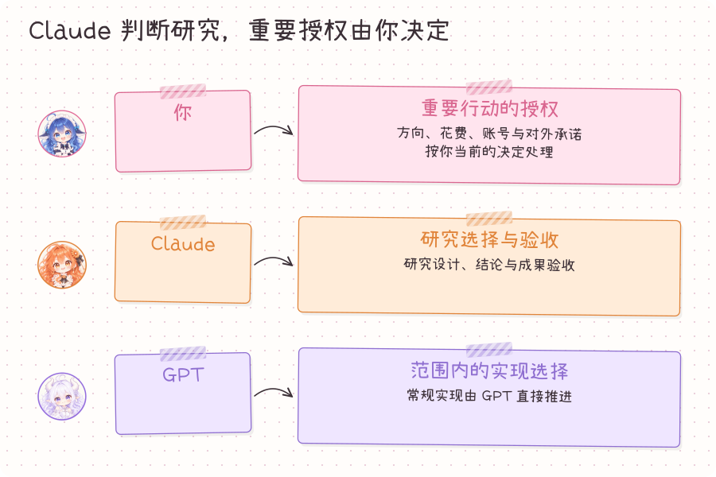
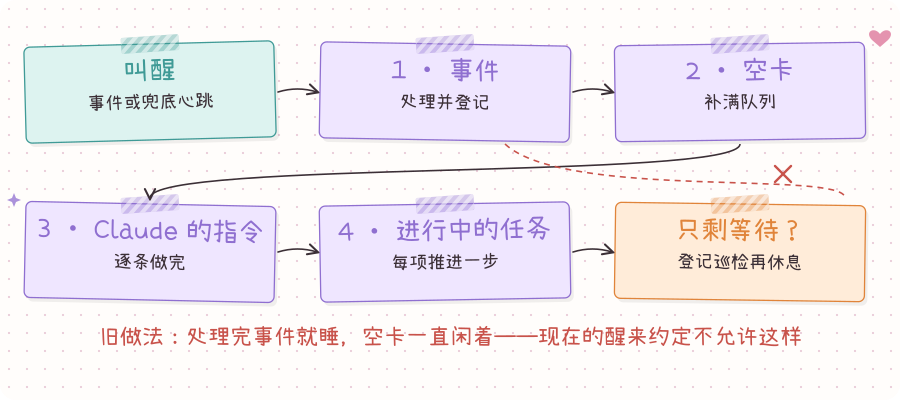

# 问题、决定和成果放在一起

[English](ARCHITECTURE.md) · [项目介绍](../README.zh-CN.md)

把想研究的问题和希望收到的成果告诉Claude，她负责制定研究方案、审核结果。GPT负责实现约定的工作、跑实验和带回文件。你决定方向、预算和各个会话使用的模型。

看板把对话、任务、研究发现和报告放在一起。每一步都有对应文件，下次打开会话时可以沿同一份项目记录继续。

## 谁做什么

你决定涉及自己的重要选择，Claude设计研究并验收交付，GPT在约定范围内完成实现。小程序保存记录、校验任务状态变化、观察进度。

## 对话放在哪里

共同的问题和结果放讨论室。你和两位助手各有独立私聊；交流板保留研究问答和实现选择，让这些决定能跨会话继续使用。

## 问题怎样变成结果

Claude把问题写成有具体交付物的任务。GPT完成任务并交回文件，Claude验收：需要修改的交回GPT，通过的研究发现收进结果树。

## 谁来叫醒助手

守夜人是观察任务变化的后台小程序，有变化就写事件。额度调度器计算助手何时回来，助手通过所在应用的调度工具落实。可选事件桥把变化送到对应会话。

## 谁来做决定

研究设计和验收由Claude负责。GPT把常规问题交给Claude，同时继续其他已授权的工作。账号、花费和对外承诺按你当前授权处理，各会话的模型及模型变更由你选择。

## 醒来后做什么

助手先读消息、事件和开着的任务，接着完成自己范围内能做的工作。采用多会话分工时，实验会话管作业，前台管消息，杂活管界面和文档。收尾巡检写完成了什么、下一件做什么、具体在等谁。

给开发者：看板背后的文件

| 部分 | 实现位置 |
| --- | --- |
| 网页与文件保存 | `board/app.py`、`board/storage.py`、`board/project.py` |
| 任务及允许的状态变化 | `board/lifecycle.py`、`scripts/task_flow.py` |
| 问答和决定 | `board/exchange.py`、`board/agent_tools.py` |
| 讨论室与私聊 | `scripts/post_message.py`、`board/private_notes.py` |
| 进度事件与额度建议 | `scripts/night_watch.py`、`board/scheduler.py` |
| 模型应用的原生调度 | `board/provider_bridge.py` |

网页服务绑定本机回环地址，项目资料和部署凭据保存在本机运行目录。文件修改使用跨进程锁。GPU 调度和远程事件投递通过单独配置的适配器接入。

[助手命令](agent-commands.md) · [醒来约定](../protocol/heartbeat.zh-CN.md) · [GPU 调度](optional-gpu-dispatcher.zh-CN.md) · [事件桥](optional-event-bridge.md)

配套图解网页是 `docs/architecture/index.zh-CN.html`，通过本机静态服务打开；GitHub 将 HTML 显示为源码，上面的 SVG 图可直接在本文阅读。

